# PySaiyanWeBoo

<p align="center">
  
</p>

[Icon](docs/brand/icon.png) · [Favicon](docs/brand/favicon.png)

Shared CSS themes, semantic UI components, and small JavaScript utilities for static interfaces across myon-bioinformatics projects.

**Static-first · build-free runtime · dependency-light · cross-repository**

## Name origin

PySaiyanWeBoo combines Py (Python), Saiyan, Web, and Boo. Like Majin Buu in Dragon Ball Z, it absorbs work from many other repositories and makes it its own. And like a Saiyan, who grows stronger through every battle and every round of training, it keeps getting better with each change and test. It serves all of this together as web pages. It was formerly named web-ui.

## v1 foundation

```text
web_ui.py        the one Python module: CSS (in memory), pages, stubs, worlds, themes
index.html       the front page: front_document() over the library's own builders, kept equal by a test (nothing is written for the page alone)
                 (example data is Python too: web_ui.EXAMPLES, example_data(), --example NAME; no examples/ directory)
                 (the browser modules are Python data too: js_modules(), write_js(); there is no js/ directory)
tests/
```

There are no css/ files and no example HTML files: the stylesheets are Python data (`web_ui.css_source()`), the example pages are built by `web_ui.example_pages()` (`python -S web_ui.py --site DIR` writes them). Modern is the default theme, not the only theme. `github-like` is the first alternate theme using the same semantic `ui-*` / `stub-*` contract.

Generic JavaScript handles browser behavior and rendering helpers. MCP/API protocol semantics remain in consuming repositories.

## Consumer-owned catalog pages

`catalog_document(spec)` builds a script-free page from repository-owned items,
settings and evidence links using the existing shared components. Analysis reports
and project directories use the same entry; data collection and Pages publication
stay with each consumer. [Schema, examples and adoption boundary](docs/catalog-pages.md).

## Python-first flow replacement

Card-style flow diagrams and atomic flow edits now belong to [ascii_artist's accepted Python implementation](https://github.com/myon-bioinformatics/ascii_artist/blob/a9af65cc443e6129176f83268142bff2c2397b66/docs/card-flows.md).
Pin `a9af65cc443e6129176f83268142bff2c2397b66` (or a later tested revision) when migrating: use `validate_flow`, `flow_html`, `flow_mermaid`, `flow_document`, `flow_css`, and `patch_flow` from `ascii_artist.py`.
The CLI routes are `python -S ascii_artist.py flow-cards` and `python -S ascii_artist.py flow-patch`; the existing small CJS entry forwards to the same Python implementation.
`flow_document()` embeds its CSS by default, so it does not depend on the removed PySaiyanWeBoo `css/` paths. The replacement retains card rendering, text escaping, bounded/atomic patch validation and behavioral regression tests; PySaiyanWeBoo no longer maintains a second flow engine.

## Themes

Current themes:

- `modern` — terminal-styled default (text is Meiryo like every theme; code stays monospace)
- `github-like` — generic light presentation intentionally using familiar GitHub visual cues
- `green`, `red`, `blue` — candidates, token-only: palettes (green first built by hand in Ironmate's studio; red and blue are `theme_palette(hue)`, and any hue works) whose values are generated into `tokens.css` (no theme files, not in contract v1 yet)

Single-file pages: `render_document(css=bundled_css())` (or `python -S web_ui.py --css-bundle`) embeds every
stylesheet and theme, built in memory from the sources in `web_ui.py`; nothing is written to the repository. Because all themes ship
together, `bindTheme()` from `ui.js` switches `data-ui-theme` live, with no stylesheet swap and no reload.
From Node, run `node vendor/py_launch.cjs -- web_ui.py --css-bundle`.

World pages (prototype): `world_document(spec)` or `python -S web_ui.py --example world > world.json; python -S web_ui.py --world world.json` builds one page that never
changes page: scrolling "shots" and a pan/zoom map with floors, categories and an info sheet (data: `web-ui-world/1`).
Python validates the data, does the camera arithmetic (`fit_zoom`, `clamp_focus`) and writes the HTML, the CSS and a
small module; the script applies state and projects interactive player motion; static Pages does not execute Python. Without JavaScript the shots stack and spots open
through `:target`. `random_theme(seed)` and `--theme-wall N` show seeded random themes side by side.

Seed dial: `theme.js` is Python's own generator written out for the page (CPython's Mersenne Twister seeded as `random.Random(int)` seeds it, the same steps), so
`randomTheme(seed)` gives exactly the tokens `random_theme(seed)` gives (checked on thousands of seeds, negative and 2^53 ones included) and `bindSeed()` wears any seed
live with no reload: `seed_dial_html()` (a dial), `seed_roll_html()` (🎲), a tap on any `[data-seed]` cell of the wall, ✖️ or a named theme (`theme_switch_html()`) to go back.
The seed is remembered in this browser. Python stays the reference; the page never invents a palette of its own.

Front page layout: `front_document(main, rooms, title=...)` is one view that fills the viewport under a 48px bar, and a 🚪 menu of rooms that open over it through `:target`
(no script; ✖️ closes). A room is `{"id", "emoji", "title", "text", "html"}`: add one to put something on the page, improve a builder to improve the page.
`index.html` is exactly that call over the library's builders (`world_html`, `stub_html`, `curl_panel_html`, `theme_switch_html`, `seed_dial_html`, `theme_wall`), and a test
requires every one of their outputs to be in it. `render_document` takes optional `favicon` / `touch_icon` PNG links for such pages.
[Motion and clock ownership](docs/world-motion.md) explains Python-generated plans, the browser
projection, keyboard/reduced-motion controls, and daily countdown/timezone semantics.
[School world](docs/world-classroom.md) adds a floor `tile` grid with solid `props` (desks, board, shelves; `classroom_floor()` writes a classroom),
world `avatars` (pick an emoji, a short text or both first) and walking by tap, arrow keys/WASD or an on-screen pad around the furniture (`EXAMPLES["school"]`). The page stays short and iconic: header 🏠 ⭐ ⚙️ plus emoji tools you add (`"tools": {"🗺️": ...}`), side ☰ ⋯ menus (places with direction arrows), a 🚪 floor pulldown in the footer; `shell: true` gives any world or `catalogue_world` the same layout.
`land` floors (`land_floor()`, `EXAMPLES["overworld"]`; themes meadow, forest, mountain, desert, coast, castle) make a Dragon Quest-style map of several lands from the same grid by swapping prop kinds (`WORLD_PROPS`, `WORLD_GROUND`, `WORLD_LOOK`). `place` floors (`place_floor()`, `EXAMPLES["cities"]`: Parallel Tokyo, Reverse London, Fake Paris) lay latitude/longitude points on the same grid with roads, a river and its bridges, using the coordinates tool's projection; a spot can `flip` to a second face when pressed or be a `sign` (an electronic or wooden board: a bold dot at a tile corner until touched) ([Places](docs/world-classroom.md#places-real-space-in-miniature)). `"real": true` floors let a visitor put a photo or the camera behind the props (🖼️📷, shown in the page only: not stored, not sent), through the same `ask()` dialog the page exposes. 🌐 speaks the 11 languages of flutter_navigation_basic; the starred places and the language are a light `localStorage` cache (`ui-world:<id>`), nothing else is stored.
From another repository: `echo '{"schema":"web-ui-world/1","floors":[{"classroom":{}}]}' | python -S web_ui.py --world - > school.html` (`--world -` reads stdin; Node: `node vendor/py_launch.cjs -- web_ui.py --world -`).

Demos, recorded from real Chrome by `python tool/record_demo.py docs/demo --force` ([what each shows](docs/world-classroom.md#demos)):

| Pick a character | Type your own | Arrow keys / WASD |
|---|---|---|
| 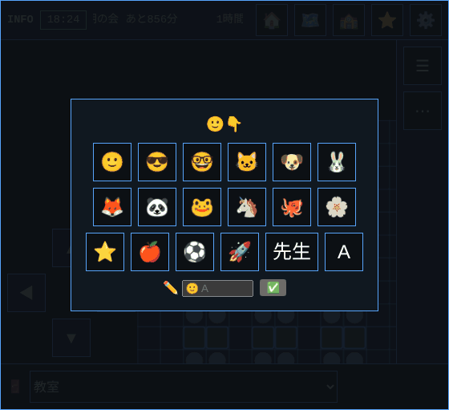 | 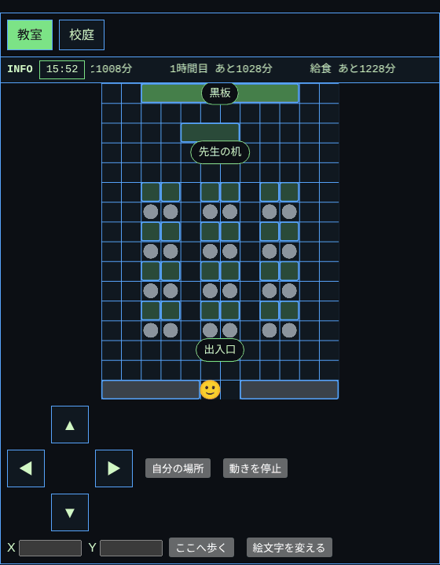 | 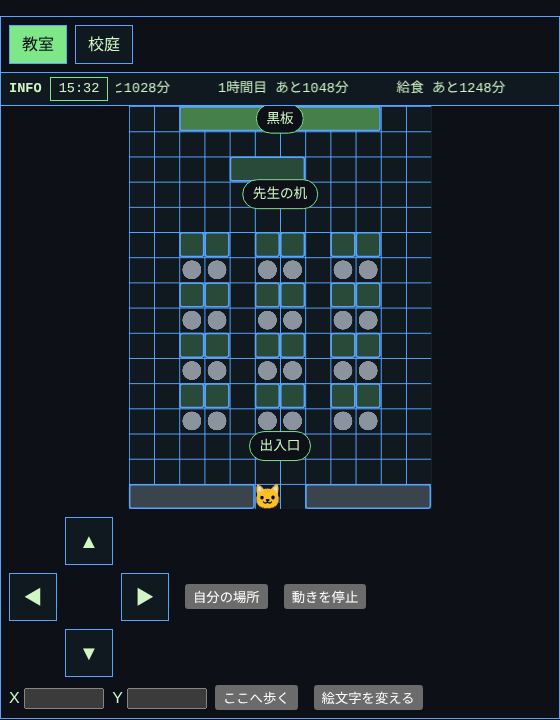 |
| **Tap to walk** | **Phone** | **Side menu (☰ ⋯)** |
| 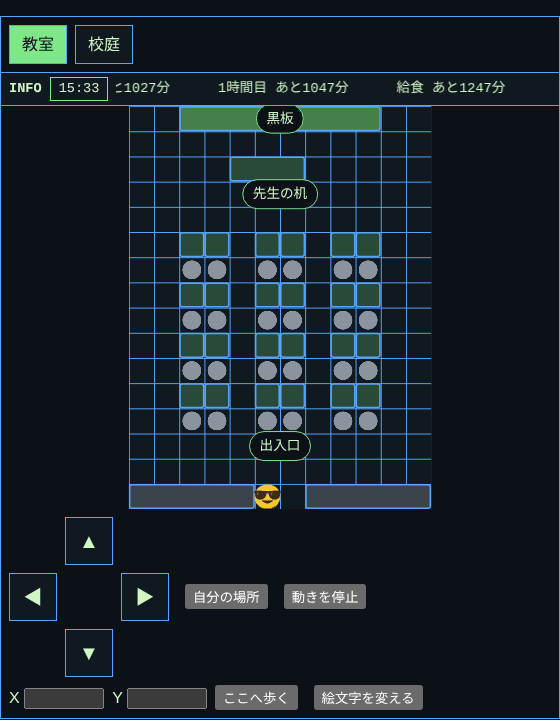 | 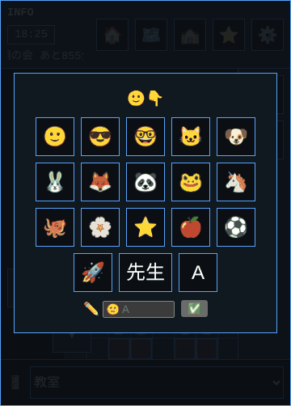 | 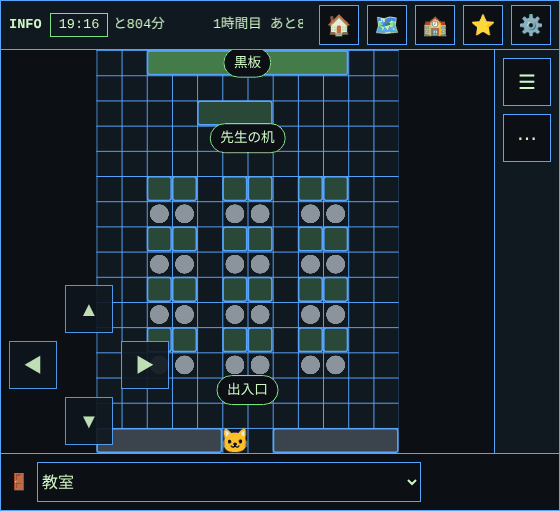 |
| **Header (🏠 ⭐ ⚙️ 🗺️ 🌐)** | **Door to door (footer)** | **Lands (🌱 🌲 ⛰️ 🏜️ 🌊 🏰)** |
| 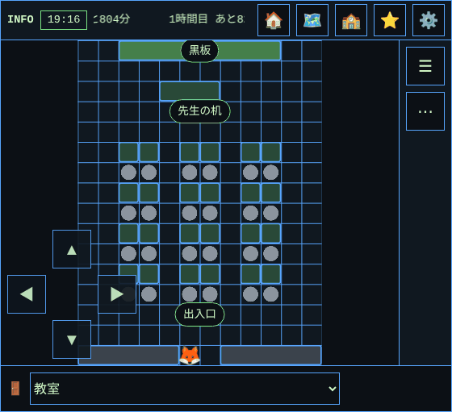 | 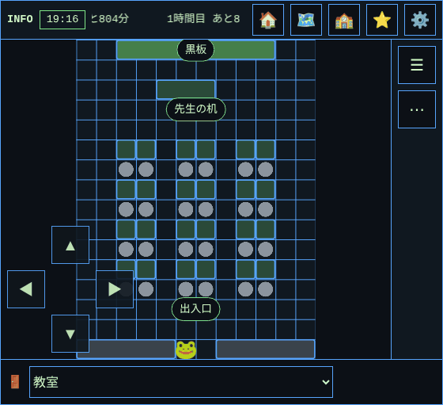 | 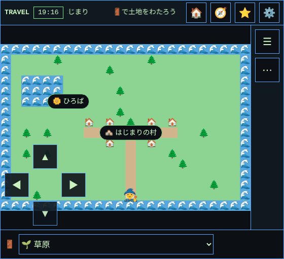 |
| **Real × virtual (🖼️📷)** | | |
| 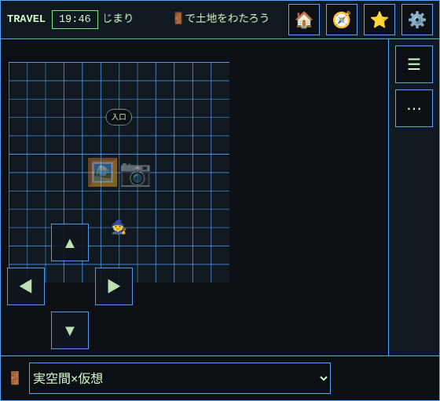 | | |


Map extras, all optional in the same spec: emoji `actors` (villagers that walk straight at constant speed and pause at random, seeded), a
`player` that walks to the spot you tap, and an info `board`. The board has a clock (`"offset_label": true` adds the UTC offset such as
`UTC+9`, never a place name), optional **zone clocks** (`"zones": [{"id": "tokyo", "label": "Tokyo", "tz": "Asia/Tokyo"}]`, up to 6;
Python builds each zone's offset table from the system tz database with `zoneinfo`, so DST is never hand-written, and the page only looks it
up; the table covers 2020-2040, `zone_rows` / `zone_offset`), items with `"at": "HH:MM"` ("in N min"), and **gauges**: `{"text": "Open", "gauge": {"from": "09:00", "to": "18:00",
"cells": 10, "glyphs": "hourglass"}}` fills `cells` glyphs as the window passes (`from` after `to` runs past midnight). `glyphs` is a preset
(`GAUGE_GLYPHS`: hourglass, moon, heart, square, dot, block, star) or any two short symbols `["🔥", "🪵"]` (elapsed, remaining); the
hourglass is just one choice. An item with `"zone": "tokyo"` (an `at` or a `gauge`) counts in that zone's local time instead of the viewer's. `"post": true` adds a one-line form: what a visitor writes is cleaned (`clean_message`), stamped `HH:MM`
and shown **on that page view only**: no storage, cookie, cache or request, and a reload clears it (Python and Chromium tests check
this). It is not shared with other visitors. All rules (`gauge_state`, `clock_label`, `utc_offset_label`, `travel_seconds`, ...) live in Python and
the page's script is tested to give identical results.

Catalogue as a map: `catalogue_world(items)` turns a flat list `{id, label, group, emoji?, category?, body?}` into a world: one floor per group
(more than 64 in a group continue on another floor, at most 8 floors), a spot per item on a grid of multiples of 8, filter chips from
`category`, and an info sheet from `body`; 198 screens fit five floors. Map your own fields first (see its docstring for flutter_navigation_basic's
`screens.json`); the data stays with its owner.

App shell: `showcase_document(spec)` (`web-ui-showcase/1`, example in `EXAMPLES["showcase"]`, generated as `examples/showcase.html`) builds a header, a
rail (256 px at 1200+, 80 px from 900) or bottom bar (narrower) and sections that switch through radio buttons: no reload, and no script for
switching. Classes `ui-shell*`, `ui-rail*`, `ui-bottom-*`, `ui-icon-button`; the optional favorite button uses `bindToggles` from ui.js (memory only)
and the theme list uses `bindTheme`. It replaces the pinned CSS copy in flutter_navigation_basic's `experiments/ui-showcase-html`.

Coordinates (`examples/coordinates.html`): `parse_coordinate` (full-width digits are read; hex is refused), `try_parse_maps_url` (`ll=`, `query=`/`q=`, the `!3d..!4d..`
place pin before the `@` viewport centre; tried as written, decoded once and decoded repeatedly), `to_dms` with the rounding carry, `tolerance_area` (the box around a
radius, date-line and pole cases), `zoom_for_radius`, `xyz_tile`, `maps_urls` and `area_texts` (JSON, bbox, Google Maps and MapKit snippets, area links), from
flutter_navigation_basic's coordinate tool. Its Dart tests and shared golden vectors (`tests/fixtures/coordinate_area_cases.json`) are the oracle; `coordinates.js` equals
Python on 500+ random areas (every copyable text byte for byte), zooms, tiles and 800 Maps-URL variants. Short-link expansion needs a network and stays out.

Photo studio (`examples/photo-studio.html`): frames and stamps on a photo, all in the page and in memory. Python is the reference: `photo_sniff` (PNG, JPEG, WebP, GIF, AVIF, HEIC
from the magic bytes; JPEG progressive and EXIF Orientation 1-8 with the marker scan that skips an XMP block and fill bytes), `photo_header_size` (the width and height a PNG, GIF,
JPEG or WebP header declares, read without decoding, so the 40-megapixel budget is checked before any engine decode), `photo_decide` (Flutter's order: a declared type that is not
`image/*`, empty or over 32 MiB, the budget, the engine decode, the budget again; HEIC that cannot be decoded says so), `photo_document_size` (two thirds, long side at most 4096),
rectangles and shapes (`photo_rect_*`, `photo_shape_contains`, `photo_describe`, hit targets), `PhotoHistory` (20 steps, gestures as one step) and `PhotoStudio` (drag to create,
move, resize, stamps, spray, undo) as one state machine, from flutter_navigation_basic's `lib/features/photo_studio`. Its Dart tests and `import_compat` fixtures are the golden
values (`tests/fixtures/photo_import_cases.json`, bytes copied unchanged with their sha256 and the outcome Flutter measured for each), and Pillow is the independent oracle for sizes,
orientation and progressive flags. `photo.js` equals Python exactly on 1,500+ damaged and generated files, 1,500 import decisions, 600 random rectangles and 90-step random
edit sessions (about 10,000 steps compared state by state); a mutation in any rule fails those tests.
**Platform differences absorbed.** EXIF Orientation is neutralised in the bytes (two bytes) and the page turns the picture itself with `photo_orientation_matrix`, so engines that turn
EXIF pictures on their own and engines that do not draw the same upright pixels (the page's pixels equal Pillow's `exif_transpose`); the blob is given the type the bytes show, not the
one the file claims; pointer events with `touch-action: none` and a pointer capture, so a finger edits the canvas instead of scrolling the page; the canvas is kept under 16 million
pixels; the PNG is saved with `a[download]` (opened in a tab where that is missing) and shared where `navigator.canShare` allows. **What is not claimed.** "Check this browser" decodes
nine tiny pictures and reports, as JSON shaped like the Flutter app's `evidence/*.json`, what *this* browser decodes (`loader_browser_canvas_adapter`) and whether it turns EXIF pictures
itself. Chromium results are measured here; Firefox and WebKit run in CI; iOS Safari (HEIC, camera, Share, `download`) is **not verified** until the page is opened on a device and
its JSON is kept; a browser emulation is not a device (see the platform notes below).

Successor tools (`examples/play-studio.html`, `examples/timeline.html`): seeded Counter garden,
reusable reward stamps, Irony quest, replay/test-input export, and dated appointments sorted
by explicit UTC instants with IANA zone labels. Composition Studio can turn its current
progression into notes and play them through an **optional local Tone.js subset**. Pure
Python remains dependency-free. [Setup, verification, migration inventory and archive gates](docs/flutter-successor-studios.md).

Composition studio (`examples/composition-studio.html`): chord theory (`scale`, `diatonic_chord`, `convert_progression` for Roman numerals, `chord_tones`,
`chord_with_inversion`, `transpose_key`, `fifth_neighbor`), metronome timing from elapsed time (`metronome_position`, `beat_micros`, `duration_label`), `tap_tempo`,
`parse_notes` / `note_bars` and a reproducible `song_seed(seed)`, from flutter_navigation_basic's composition_generator. Its Dart tests are the golden values;
`composition.js` is checked against Python on every key, mode, chord quality and inversion, 1,500 metronome positions and random progressions, tap trains, notes
and seeds. Deliberate differences: separators are ASCII whitespace and commas, rounding is half up on integers, and seeds use `mulberry32`.

Door-to-Door and emoji transitions (`examples/door.html`): `door_validate` keeps one emoji per page (variation selectors and spaces do not count, so `🗺️` and
`🗺` collide) and only safe targets (a relative path or an http(s) address); `emoji_path("🏠 → 🗺️ → 🌍 ↔ 🕶️", pages)` expands `A → B` (go) and `A ↔ B` (go and come
back) into the hrefs visited, and an unknown emoji returns nothing at all; `door_options` orders the pull-down as Home, the drawn discoveries, then the rest.
The draw is seeded (`mulberry32`, `door_draw`): the same seed draws the same pages in Python and in the page (`door.js`), checked bit for bit in Chromium.
A listener on `ui-door-leave` can cancel a trip (a "really leave?" guard) without a dialog.

Clipboard shelf (`examples/clipboard-shelf.html`): paste text, a URL, Markdown or a Base64 image into a shelf that lives in the page only (no storage, no
requests; a reload empties it). Python is the reference: `shelf_classify`, `markdown_plain`, `looks_like_image`, `decode_image_text` (strict: PNG, JPEG,
WebP by their first bytes, a declared type must agree, URL-safe Base64, `%3D` and missing padding are refused, 32 MiB cap), `build_prompt` (the prompt
workbench) and `shelf_bundle`. `shelf.js` gives identical answers; Chromium checks it on Ironmate's 19 Base64 cases
(`tests/fixtures/base64_bridge_cases.json`, Ironmate@56020aef) and on seeded fuzz. Filtering and ordering are radio buttons, so they are CSS.

Clipboard loops (cut, paste, copy back, repeat), on the shelf page and the photo studio: the shelf takes text, images from a file, a drop, a paste or Base64, keeps at most 20
items and 32 MiB (Ironmate's budget; Flutter had none; the page checks again when a slow read finishes) and drops a read that a Clear overtook. `clipboard_pick` reads the
system clipboard in Ironmate's order, with injected `read_text` / `read` so every case is testable: image text first (an invalid `data:image` or an image signature is an
error, never a stale older image), then the first PNG, JPEG or WebP item (a denied text read does not stop it; an oversized item is never read), then (shelf only) plain text;
the failure is one of `clipboard-unsupported`, `-denied`, `-invalid-image`, `-read-failed`, `-no-image`. Ironmate's 35 scenarios (`tests/studio_clipboard.cjs`) are the golden
values, and the same code in `shelf.js` and `photo.js` equals Python on them, on damaged texts and on the 32 MiB boundary (raw, URL, binary, over by one byte). The
temporary clipboard (`session_clip_save`, from Flutter's `SessionTextClipboard` and its Dart tests): 30 entries, 100,000 UTF-16 units each (an emoji counts 2), a repeat moves
to the top. It lives in the page, so a reload empties it and, with no storage, it does not follow you to another page (Flutter kept it while you navigated). The photo studio's
`Paste photo` uses the same reading order, and `Copy as Base64` hands the exported PNG back as `data:image/png;base64,...` or plain Base64, which the shelf reads back byte for
byte (`png_base64_text`). The Image studio below takes in Ironmate's image editor: it reads photos the same way, and what it exports comes back to the shelf unchanged.

Playground (`examples/playground.html`): the Counter Playground, its hold-to-repeat button and the Irony generator, from flutter_navigation_basic's `counter_playground`,
`hold_repeating_button` and `irony_generator`. `counter_apply(state, action, value)` is the controller as a pure function (clamped to -100..100, steps 1, 5 and 10, a history of the
eight newest values, a move that changes nothing leaves the burst token alone, `undo` returns to the next value and records nothing); `counter_effect` / `counter_label` /
`counter_status_key` are the orb strip (at most six), the line under it and the seven-step status text. `hold_repeat_count(held_ms, buttons=)` is the hold rule: nothing for 350 ms, then once,
then every 70 ms, primary button only, and the click after a hold is swallowed once. The irony card: `irony_next` never returns the one on screen (Dart's pick among the other
`n - 1`, skipping the current index), and `irony_drop(arena, card, handle)` decides what a drag does from three rectangles: the card entirely outside the arena (edges that only touch
do not count as inside) spawns the next message, otherwise the whole handle plus 8 px of padding must be inside or the card moves by the least that brings it in (a handle as large
as the arena is centred). The Dart tests are the golden values; `playground.js` equals Python on seeded action runs, 3,000 random drops and every counter from -105 to 105, and
Chromium drives the page (mouse, a fake clock for the hold). Deliberate differences: the random pick uses the Door's seeded `mulberry32` (Dart's `Random(7)` cannot be reproduced),
and a "New irony" button gives keyboard users what only the drag gave. The probe's two adapters are `web-ui-playground` (the counter) and `web-ui-irony`; the second opens at its
heading because the probe wants everything on the first screen.

Test reports (`examples/test-report.html`): the JUnit and test-runner tools of flutter_navigation_basic (`outcomes`, `flutter_machine_junit`, `validate_runner_junit`, `junit_history`,
`failure_identity`, `multi_test_runner`, `node_test_runner`, `expected_child_failure`), in the one file. `junit_report(xml)` reads a JUnit report **failing closed** (missing or malformed XML,
a root that is not a testsuite, no testcase, a testcase without a name, a DTD or entity declaration, over 1 MB), finds testcases at any depth (Node nests `describe()` blocks), and counts
`passed / failed / skipped / xfailed / xpassed / error` (a `skipped` that says `known:` or `xfail:`, or has type `pytest.xfail`, is an xfail); a failure carries the SHA-256 of its message,
not the message. `flutter_outcomes(events)` tallies the Flutter JSON reporter the same way and `flutter_machine_junit(events)` converts it to per-case JUnit (hidden loading tests dropped, a
failed load kept, `classname` is the suite path, anything incomplete is an error). `junit_failure_records` / `junit_history` / `junit_diff` give a failure its identity (class, test with the
parameter suffix removed, kind) and say what is new, recurring or resolved between two runs; `failure_ledger_update` and `attempt_history` keep fingerprints and the "a retry never masks
the first failure" record; `runner_command`, `run_test_suite` and `node_test_run` are the allowlisted Deno / Playwright / Node runners (no shell, files inside the repository, stale reports
removed first, a missing or all-skipped report fails closed); `expected_child_failure` runs a command that is *meant* to fail and keeps bounded evidence. The command line:
`web_ui.py --junit FILE... [--previous FILE]`, `--flutter-events FILE [--to JUNIT.xml]`, `--run-tests RUNNER --test-file F`, `--expect-exit CODE --output-dir DIR -- command`.
The Python tests of those eight tools are the golden values (ported case by case); `report.js` equals Python on 900 Flutter event streams (a third of them damaged), about 800 JUnit documents
(generated, damaged and hand-picked: namespaces, CDATA, comments, entities, a DTD, the 1 MB edge, 250-emoji names) and seeded history and ledger runs; its SHA-256 is the page's own
(no `crypto.subtle`, which needs a secure context) and equals `hashlib`. Deliberate differences: a failed, non-hidden `loading <file>` test is an `error` (the tally used to skip
every loading test, so a compile error looked like zero tests); `ok` needs a passed test (nothing ran is not green); a boolean is never an ID and only JSON `true` is a flag (the page
cannot tell `1.0` from `1`); only strings are names, reasons and error text; messages never contain the input; characters XML 1.0 cannot carry are written as U+FFFD; a missing class is
`(none)` in an identity (the originals refused the whole report). The BTK adapter is `web-ui-test-report`.

MCP lab (`examples/mcp-lab.html`): flutter_navigation_basic's `lib/shared/mcp` and the mock server's routes (`build_tools/src/mock_mcp.dart`), as an MCP server that lives in the page
(nothing is sent). `McpFoundation` is the dual-era demo server as a state machine: legacy `2025-03-26` (`initialize` opens a session, `Mcp-Session-Id` after it) and current-official
`2026-07-28` (`server/discover`, no session, `_meta` on every request, results carry `resultType` and lists `ttlMs` and `cacheScope`); `echo`, `demo://readme`, `greet`. `McpRoutes` is
the HTTP layer with its status rules (400/404 for a missing or unknown session, 400 for a request that does not match its `_meta`, 404 for an unknown current-era method but 200 for a legacy
one, 202 for an accepted notification, 403 for an Origin that is not listed, 401 or 403 for a Bearer, 405 for a GET) and the OAuth discovery documents; `McpClient` checks everything it
is told (well-formed JSON-RPC, the id it sent, a non-2xx is never success, no session is kept from a failure) and runs both echo demos; `mcp_validate_modern` is the header/body check in the
Dart order. The helpers: `mcp_header_encode/decode` (a header name that is not printable ASCII travels as `=?base64?...?=`, checked strictly), `pkce_challenge_s256` (RFC 7636 Appendix B is
the oracle), `oauth_server_metadata` / `oauth_resource_metadata` (a server's silence is never read as a promise), `bearer_inspect` (expired is reported before a wrong audience; the signature
is not checked), `rpc_response_parse`. The Dart tests are the golden values (ported case by case); `mcp.js` answers every request of 120 seeded scripts (8,400 requests with damaged
envelopes, headers, Origins and Bearers) exactly as Python's server does, and equals it on the client's handling of 26 canned replies, 800 header names, PKCE, session ids, Bearer
tokens and OAuth documents. Deliberate differences: ids and verifiers come from an injected random source (Dart's `Random(42)` cannot be reproduced; the default is the OS's), the
Bearer clock is in seconds and `Authorization` splits on ASCII whitespace, and the page cannot tell `-32603.0` from `-32603`. The in-process transport of the Dart repo (session errors as
400 and 404, no Origin, no Authorization) is `mcp_foundation_transport`. The Digest/HMAC auth matrix is a separate mock and is not part of this. BTK adapters: `web-ui-mcp-lab`, `web-ui-mcp-send`.

Patterns (`examples/patterns.html`): flutter_navigation_basic's 792 patterns and the processing behind its data-processing ones. The catalogue (`pattern_catalogue()`, 198 patterns in each of
navigation, API, UI/theme and data processing: id `A001`...`D198`, title from the pattern's README, theme from `PATTERNS.md`) can be searched (`pattern_find`: NFKC, case-folded words in the id,
title or theme, plus category and family). For the data-processing patterns it also says who owns each in the original (`pattern_owner`, the rules of its responsibility audit: Python, JavaScript,
Flutter-native, undecided) and which reference here implements it (`pattern_family`). The navigation, API and UI patterns are Flutter screens: they are catalogued, not reimplemented.
The references are the fourteen Python oracles (`collection_query_patterns`, `search_patterns`, `pagination_patterns`, `scoring_heap_patterns`, `state_reducer`, `conversion_patterns`,
`validation_patterns`, `workflow_patterns`, `collection_transform`, `list_selection`, `list_ordering`, `text_processing`, `collection_window`, `collection_structure`) and the five JavaScript ones
(`future_patterns`, `stream_patterns`, `concurrency_patterns`, `event_loop_patterns`, `interaction_patterns`, patterns 4, 35 and 121-150) as `pattern_run(family, request)`, one JSON request in
and one JSON result out, or a `ValueError` with the original's text: `query` (stable sort, named comparators, group, facet, tag, range, haversine radius), `search` (tokenize, a suffix stemmer,
history, fuzzy, autocomplete, highlight), `page` (offset, and cursors bound to the SHA-256 of the exact dataset), `score` (TF-IDF, min-heap), `reduce`, `convert` (NFC/NFKC, strict coercion,
dates, units, UTF-8/Base64, masks), `validate` (a named-regex allowlist, never a user pattern), `workflow` (swap, move, sorted insert, undo/redo with a discarded redo branch, batch, saga rollback,
pub/sub, CQRS, checkpoints), `transform` (a typed schema, `true`, `1` and `1.0` kept apart), `select`, `order`, `text`, `window`, `collection`, `structure`; and `future` (Promise basics, all, race,
timeout), `stream`, `concurrency` (queue, semaphore, mutex, cancel, progress), `event_loop` (sync, microtask, promise, timer) and `interaction` (`pattern_virtual_window`, a debounce through
`PatternDebouncer` on a virtual clock). The JavaScript ones are modelled without a clock: a task has a delay, and what finishes first is a sort on (delay, creation order), as Node's timers do
(0 ms waits 1 ms, a tie goes to the earlier created); numbers read as JavaScript reads them (`1.0` is the integer 1). `python3 web_ui.py --pattern FAMILY` runs one on stdin (`list`, `catalogue`;
NaN, Infinity and numbers beyond the float range are refused). The golden values are the originals' own outputs, never this code's: the 34 files of `assets/data_processing/` that the Dart app
shows are reproduced exactly (`tests/fixtures/pattern_assets.json`), and 1,145 requests recorded from the originals (the Python oracles, and the Node modules for the JavaScript five), answers and
refusals with their text, are reproduced exactly (`tests/fixtures/pattern_golden.json`, taken at 39d659e); during development every family was also run against the originals themselves on
seeded requests (3 x 4,000 per Python family, 1,500 + 3,000 per Node family), with no difference once the timers of one request are kept from mixing with another's. Deliberate difference: where an original crashed with a
`TypeError` (an unhashable `operation`, say) this raises `ValueError`; where it would leave a task promise unhandled, the page's copy handles it. `patterns.js` runs nineteen families in the
page (the seventeen above, and `screen` and `native` below): the sync ones answer 1,200 seeded requests per family like Python, refusal text included, and the five JavaScript ones run on real promises and timers (a virtual clock in the tests) and
answer 700 seeded requests each; every cap is tried at its edge in both languages. `search`, `convert` and `validate` stay in Python because they rest on CPython's case folding, integer parsing
and `urlsplit`, and so does TF-IDF (the min-heap runs in the page), and so does `contract` (below); the static page shows what Python answers to their examples, and the page that
`python3 web_ui.py --pattern-serve` serves runs them in Python (see the bridge below). Limits of a page: JSON cannot tell `1` from `1.0` (an integral number
is an int), integers beyond 2^53 are not exact, and the catalogue search lower-cases where Python case-folds. The Flutter-native patterns (136-137, 151-175, 183-184) and the screens of every pattern are the next section. Not absorbed: the 594
`view.dart` files of the navigation, API and UI patterns (the inventory detects one shared heuristic shape across all three categories; this does not prove behavioral equivalence or completed migration) and the Digest/HMAC auth matrix mock (not yet).
BTK adapters: `web-ui-patterns`, `web-ui-pattern-run`.

Screens (`examples/screens.html`): the 198 numbered screens of flutter_navigation_basic, its Hub and the native examples. A screen is data (`screen_row(n)`; `tests/fixtures/screens_asset.json` is
assets/screens.json byte for byte): one pattern from each of the four categories, a domain (18, in blocks of eighteen), a use case, and for the 22 integration and auth screens a design note (purpose,
when, three points, a pitfall, a snippet). One of eleven templates draws it (`screen_template`, from the id), the chrome texts come in 11 locales (`screen_text`, 59 keys, golden against
assets/display/app_text.json), and `screen_view(n, locale, state)` returns the whole screen as data: title, chips, tabs, body, use case, links to the pattern's sources and to the references here
(`screen_links_view`; screens 91-99 and 103-110 show those as well). The Hub is `screen_hub(locale, query, mode)` (list or grid, a search over the catalogue with the original's rules), and
`screen_step(n, state, event)` is the state machine of one screen (input, tab, template switch). The native examples of patterns 136-137, 151-175 and 183-184 are `native_initial`, `native_step`,
`native_view` and `native_parallel`: counters and notifications as the Flutter API counts them, and the parallel pattern 136-137 in a Web Worker where Dart uses an Isolate; each card on the Hub page has the address `#native-N`. `screens.js` gives the same
answers (`screen` and `native` are families of `pattern_run` and run in the page); Chromium checks the Hub, every template in several locales, the native examples with real mouse drags and a long
press, the search text and count across resizes from 1180 to 320 px (the original's Screen6 specs), and tap targets of 40 px (24 px for checkboxes). Deliberate differences: Flutter widgets are semantic HTML,
the screens' data and texts are embedded in the page (no load-error state), screen 5 (the URL-parameter tool) is its generic screen with a note, and the native examples count notifications and rebuilds,
which the Dart ones do not display. BTK adapters: `web-ui-screens`, `web-ui-native-patterns`.

Contracts (`pattern_run("contract", ...)`, `python3 web_ui.py --pattern contract`): flutter_navigation_basic's `metadata_contracts.py` (the 198 screens and the eleven locale tables),
`header_contracts.py` (measured box geometry: inside the viewport, aligned on one row, stacked with a minimum height) and `gesture_paint.py` (a swap of two cards judged on saved PNGs: exact RGBA
comparison with changed pixels, ratio, bounding box and largest difference). `operation` is `screens`, `locales`, `layout` or `swap`; the answer is `{ok, failures, ...}` (at most 50 reasons, `truncated`
counts the rest), and a request that is not a well-formed measurement is a `ValueError`. Python only: a page cannot decode a screenshot the way a Playwright run saved it, and these are checks that a
test or CI runs. The oracle is the original itself: `tests/fixtures/contract_golden.json` holds the verdict and the messages of the originals on seeded mutations of the real data (and the hash of each
mutated document), taken at ae3c4cb; `python3 tool/contract_golden.py CHECKOUT --check` (or `FLUTTER_NAVIGATION_BASIC_CHECKOUT=CHECKOUT` with the test suite) regenerates it from a checkout and compares.
Deliberate differences: every failure is listed, not the first; `count` allows a smaller catalogue; locale placeholders must equal English's for every key; the header's title-emoji identity belongs to Flutter's
shared header and is left out; PNGs are decoded by `studio_png_decode` (8 bits, not interlaced, at most 4 MP); a bool where a number is wanted is refused.

Bridge (`python3 web_ui.py --pattern-serve [--port N] [--allow-origin ORIGIN]`): flutter_navigation_basic's `validation_http.py` (a loopback HTTP server that runs a reference), for every family.
It serves the patterns page at `/` with its Run box wired to `POST /pattern/FAMILY` (a JSON request in, the result out, `{"error": text}` with 400 for what the command line refuses), so `search`,
`convert`, `validate`, `contract` and TF-IDF run in Python from the page. It binds 127.0.0.1 only; the Host must be `127.0.0.1:PORT` or `localhost:PORT` (a name that resolves to loopback is refused:
DNS rebinding), a browser's Origin must be the bridge's own or one given with `--allow-origin` (an origin, no wildcard; the answer echoes that one origin with `Vary: Origin`, and the Private Network
Access header is sent only to it), the body must be `application/json` with a Content-Length of at most 64 KiB (415, 411, 413; 408 when it never arrives), nothing is logged, and a failure inside a reference
is `500 internal error` without its text. Chromium checks the page against Python on seeded random requests (answers and refusals), that a family the page runs itself is never sent, an unreachable bridge, a
late answer or failure that must not overwrite a newer one, no cookies or referrer, and that a page of another origin, a form post and a rebinding host get nothing.

Image studio (`examples/image-studio.html`): Ironmate's image studio (`studio/core.js`, `studio.js`, `image_studio.py`, `docs/image-studio.md`) with Python first. A scene (`ironmate-image-studio/1`: rect, ellipse,
triangle, text, image, heatmap, arrow and clock layers, at most 100 layers and 4 MP, 64 to 4096 px a side) is checked by `studio_validate` (the originals' refusal text, in Japanese, kept word for word), drawn to SVG by
`studio_svg` (the one function the page, its exports and the command line all draw with), and kept in `StudioHistory` (40 states; an edit that changes nothing is not recorded) and in a workspace file
(`studio_workspace_text`, `ironmate-studio-workspace/1`, every state with its images, at most 32 MiB of UTF-8). Around them: the five-stop heat colour with optional levels, `studio_matrix` (a numeric matrix or a Plotly
heatmap trace into heatmap data: row 0 on top, `null` kept as a gap), the alpha-weighted mosaic (`studio_mosaic_rgba`, always recomputed from the kept original, never from a mosaic), arrow geometry, output size
(0.25 to 8 times, at most 8192 px a side and 16 MP), the PNG payload for Base64 hand-off, and a small PNG reader and writer (`studio_png_decode`: 8 bits, not interlaced, every filter and colour type) so the command line
can mosaic photo layers. `studio_place`, `studio_text_layer`, `studio_matrix_layer`, `studio_image_layer`, `studio_demo_scene` and `studio_stamp_demo_scene` are what a click or a button puts on the canvas. Command line:
`python3 web_ui.py --studio-render FILE [--format svg|json] [--scale N]`, `--studio-heatmap FILE` (a matrix into an editable scene) and `--studio-base64 FILE [--data-uri]`, each with `-o FILE` (never replaces a file
without `--force`); a bad input is exit 2 with a message. The golden values are Ironmate's own `core.js` run by Node, never this code: 1,859 results (`tests/fixtures/studio_golden.json`, taken at Ironmate 3b7c07d) cover every
function on seeded scenes and on the cases of Ironmate's own tests (`test_image_studio.py`, `studio_workspace.test.cjs`), each limit at its edge, each rule of the text breaker, both of its demos (ids aside) and 471
sines and cosines; during development the Python port was also run against `core.js` itself on random scenes (5 x 2,500 per function) with no difference. `imagestudio.js` gives the same answers in the page: Chromium
checks the recorded values, 250 random scenes (SVG text compared to Python's), 400 damaged scenes (same refusal text), the layers a click places (key order too), random histories, workspace text, mosaics and every limit,
and then the editor itself: each tool places its layer where the canvas was pressed, a layer is selected, moved and resized by pointer and arrow keys, the inspector refuses what the scene refuses, a photo is added, kept
exactly and mosaicked from the original (pixels equal to Python's), Base64 and clipboard images, PNG, SVG, Base64, JSON and workspace files are written and read back, and the page fits a 320 px phone. Deliberate
differences from the originals: wrapped text breaks at the same places in every browser and in Python, so the Japanese dictionary of `Intl.Segmenter` is not used (a Han or Hiragana character stands alone, Katakana runs
together; Latin, Hangul, emoji and the rest follow ICU, checked against it on every assigned code point and on 120,000 random strings); text is measured with the installed fonts in the page and with a fixed width estimate
(0.65 em for printable ASCII, 1 em otherwise) in Python and the command line; the clock's hands use fdlibm's sine and cosine written out in both languages, so the SVG text does not depend on the engine; a text stamp's
name takes twelve characters, not twelve UTF-16 units; JSON is read as JavaScript reads it (every number a double). Not absorbed: the slides and PPTX tools, the pixel-art tools and Ironmate's own shelf dialog (the clipboard
shelf is `examples/clipboard-shelf.html`). BTK adapters: `web-ui-image-studio`, `web-ui-image-stamp`.

curl import: `parse_curl(text)` reads a curl command (the editor's subset: `-X -H -d --data-urlencode -u -G -I -A -e --url`, quoting, line continuations,
full-width characters) into method, URL, headers, query, body mode and form fields, with credentials marked `sensitive`; `mask_curl` shows them
as `***`. It never runs curl or sends anything, and error codes never contain the input. The page's `curl.js` (front page, "Request draft")
reads it the same way: Chromium checks it against Python on flutter_navigation_basic's 47 golden cases (`tests/fixtures/curl_request_cases.json`,
copied from its `python/fixtures/` at 39d659e) and 1,500 seeded inputs.

Source panel: `source_panel_html(spec)` is a name box (**Fetch**, **Open JSON**) plus a paste box (**Extract**) that turn one JSON response into Markdown tables, read through a
declarative `spec` the consumer owns (name pattern, one `https://…{name}` address, a title and table layout; see `docs/source-panel.md`). Python is the reference
(`source_spec`, `source_name`, `source_url`, `source_extract`, `source_markdown`); `source.js` and `_CSS["source.css"]` are Python data like the other modules, so a consumer
writes no JavaScript or CSS of its own. Fetch sends one GET per press and never retries; every failure is a message, and pasting needs no network. Chromium checks the page offline
and over HTTP (`tests/integration/source_browser.py`); `tests/fixtures/source/cases.json` runs through both languages.

`ui.js` (`js_source("ui.js")`) is the shared helper module: `setText`, `prettyJson`, `copyText` (with a fallback where the async
clipboard is missing), `bindTheme`, `observeLit` (marks on-screen elements with `data-lit`) and `bindLightbox`
(click-to-enlarge in a `<dialog>`). Import only what a page needs.

Theme files are presentation-only. Consumers keep the same semantic HTML and
switch `data-ui-theme` plus the loaded theme stylesheet.

Typography is shared, not per theme: `--ui-font` (Meiryo, メイリオ, then `sans-serif`) for text and
`--ui-font-mono` for `pre`, `code`, `kbd` and `samp`. The code rule is `!important` so it also wins over
an adapted page's own `pre, code { font-family: inherit }`. No font file is bundled (Meiryo cannot be
redistributed), so systems without it, such as macOS, iOS and Linux, fall back to their `sans-serif`.
`plotly_figure` defaults `layout.font.family` to `web_ui.UI_FONT`, the same stack; a figure's own
`layout.font` keys win. PPTX output already defaults to `Meiryo`.

The alternate-theme example page is `example_pages()["examples/github-like.html"]`; CI writes the example pages
with `python -S web_ui.py --site build/site` and captures desktop/mobile screenshots of them.

Theme screenshot filenames follow
`web-ui-<theme>-<viewport-name>.png`, for example
`web-ui-github-like-mobile-390x844.png`. The 390x844 capture is the responsive
contract evidence: `.ui-grid` collapses through the existing mobile component rule.

## HTML contract v1

The v1 compatibility surface is now frozen under
[`contract/v1/`](./contract/v1/):

- `contract.json` — machine-readable source of truth
- `README.md` — normative compatibility rules
- the canonical structural fixture, `example_pages()["contract/v1/example.html"]`, built in memory and used by CI
- [`contract/COMPAT.md`](./contract/COMPAT.md) — version-lane coexistence policy

Within v1, stable classes may be extended but are not removed or semantically
repurposed. Breaking semantic changes require v2.

Consumers should treat the semantic HTML surface as the reusable contract:

- shared presentation classes use the `ui-*` namespace
- Stub-specific presentation classes use the `stub-*` namespace
- themes are selected with `data-ui-theme` on `body`
- consumers own content, protocol semantics, validation, and domain behavior
- user-controlled text should be rendered as text, not interpreted as HTML

Modern theme usage (`render_document(css=bundled_css())` embeds the stylesheet):

```html
<body data-ui-theme="modern">
  <main class="ui-page">
    <section class="ui-panel">...</section>
  </main>
</body>
```

A future theme should be able to replace the theme source and the `data-ui-theme` value without changing the semantic component structure.

### Stub workspace pattern

The MCP and API stub pages (`stub_document(EXAMPLE_STUBS[...])`) share the same
responsive `stub-*` workspace. On wider viewports, the primary result pane
sits beside a secondary evidence/history sidebar. At `max-width: 720px`, the
workspace reflows to one column and the supporting region follows the result.

`.stub-meta` is for compact status or capability badges associated with the
tool page. `.stub-endpoint` is deliberately presentation-only: consumers
replace the placeholder with their own endpoint or connection label, while
request construction, protocol behavior, validation, history, evidence, and
export behavior remain consumer-owned.

For example:

```html
<div class="stub-meta">
  <span class="ui-tag">mcp</span>
  <span class="ui-tag">ready</span>
</div>
<p class="stub-status">
  Endpoint: <span class="stub-endpoint">/consumer-owned-endpoint</span>
</p>
```

The shared examples are structural fixtures, not reference implementations of
MCP or API semantics.

## Local preview

```sh
python -S web_ui.py --site build/site
python -m http.server 8000 --directory build/site
```

Open `http://localhost:8000/index.html`, or `/examples/index.html` for the example list.
`--site` writes the HTML, generated browser modules, and the icon/favicon assets referenced by the front page.
The generated front page embeds its modules and can also be opened with `file://`; separately linked modules require HTTP(S).
Use `write_js(output_dir)` when only browser modules are needed; source checkout paths under `css/` and `js/` are no longer public asset URLs.

## UI verification

Run the unittest-compatible subset of the static contract checks locally
(13 cases in the validated snapshot). Module-level pytest functions in the same
file remain part of the full pytest lane:

```sh
python -S -m unittest discover -s tests -p test_static_contract.py -v
```

Pytest lanes, including those contract modules, run with uv:

```sh
uv run pytest -v
```

Stagehand is an opt-in dependency group, so the default sync does not install it. The Stagehand tests run in the tooling-smoke lane with `uv run --group stagehand pytest -v`.

The `-v` output identifies the failing contract by test name. If a browser screenshot fails in CI, inspect the `UI smoke` job first; successful screenshot runs publish the `web-ui-screenshots` artifact.

GitHub Actions captures Chromium screenshots at two explicit v1 viewports:

- `desktop-1440x900`
- `mobile-390x844`

Screenshot filenames follow `web-ui-<viewport-name>.png`. New viewport or locale variants should extend the descriptive suffix rather than replace the existing names, for example `web-ui-tablet-768x1024.png` or `web-ui-mobile-390x844-ja.png`.

The first phase intentionally treats screenshots as observable test evidence rather than a pixel-perfect blocking regression test.

## 🎞️ Browser evidence

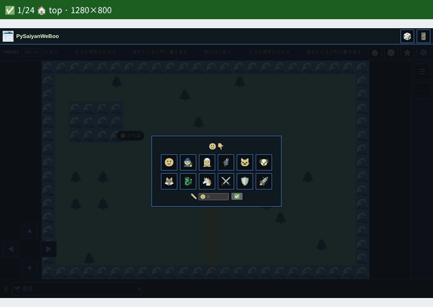

🗓️ 2026-11-07 · 🧭 Chromium 153 · 🐧 Linux · receipt [`docs/evidence/browser.json`](docs/evidence/browser.json) · tested commit is in the receipt

| 🧪 Suite | ✅ | 📝 |
| --- | ---: | --- |
| `tests/integration/school_browser.py` | 18 | |
| `controls_browser.py` | 162 | |
| `layout_presets_browser.py` · `route_table_browser.py` · `source_browser.py` | 5 · 1 · 1 | |
| `plotly_browser.py` | 3 | Plotly.js from npm `plotly.js-dist-min` (CDN unreachable here) |
| `successor_browser.py` | 3 | audio built; PulseAudio null sink |
| `tests/integration/test_gradio_dom.py` | 1 | BrowserTestKit main instead of the pinned commit |
| `tests/world_shared.browser.cjs` | desktop + mobile | |
| BrowserTestKit `platform_probe` × 17 adapters | 34 | Chromium desktop + Pixel |
| 🎞️ evidence GIF shots | 24 | |

🚫 Firefox / WebKit not installed here, so only the Chromium lanes ran.

🔁 Re-record:

```sh
python3 -S web_ui.py --site build/site
python ../BrowserTestKit/tools/evidence_gif.py docs/evidence/browser.gif --serve build/site --plan docs/evidence/browser.json
```

## Visual regression

The deterministic Chromium screenshot lane now also runs
`scripts/check_visual_regression.py`.

The rollout is intentionally two-stage:

1. candidate mode: screenshots are validated as PNGs and compared when a reviewed
   baseline exists;
2. enforcement mode: `--require-baseline` can be enabled once all stable
   contract fixtures have reviewed baselines.

Baseline updates are reviewed UI changes, not automatic CI output.

The checker requires an existing candidate directory and emits an explicit
setup error if no PNGs match the configured pattern. By default it considers
`web-ui-*.png`; `--pattern` can narrow enforcement to stable contract
fixtures before examples/gallery captures become blocking.

CI currently runs the checker with Python 3.15. The script uses Python 3.9+
built-in generic type syntax such as `tuple[int, int]`.

## Roadmap

- expand the component gallery
- consolidate Ironmate metadata-only discovery in the portfolio; retain working consumer demos
- add API/MCP Stub patterns without moving domain logic into PySaiyanWeBoo
- expand themes beyond Modern and GitHub-like
- keep HTML contract v1 stable while `markdown.py` and `ascii_artist` integrations adopt it

The bootstrap work was tracked in #1 (closed).


## Development tooling

Browser/UI verification keeps two separate lanes: deterministic Playwright/Chromium smoke tests and optional Stagehand v4 agent-oriented experiments. Git/gh and Python tool versions are captured as advisory CI metadata. Repository identity comes only from the pinned canonical Python producer, in separate JSON/JSONL artifacts. See [TOOLING.md](./TOOLING.md).

## Shared screenshot checks

CI checks all six named Chromium desktop/mobile PNGs with BrowserTestKit at
`6a2e32a4bbe49be5268e6b30040d665a89eecf66`, checked out separately in the screenshot job.
See the [shared screenshot guide](https://github.com/myon-bioinformatics/BrowserTestKit/blob/6a2e32a4bbe49be5268e6b30040d665a89eecf66/docs/screenshot-evidence.md).
The shared structural PNG checks supplement the existing local candidate/baseline
comparison. Missing/invalid required captures fail CI; available PNGs are uploaded
even after failure (14 days). This lane does not measure Firefox/WebKit; image validity does not establish semantic correctness.

The screenshot lane now seals a current-run multi-image receipt via pinned
BrowserTestKit, requires all six PNGs and their recorded SHA-256/size, and
checks the explicit tested head SHA plus run ID/attempt. Output is cleared before
capture. Failed receipts are preserved but cannot cover required success. CI also
mutates isolated copies of the real bundle to prove rejection of missing images,
wrong hashes, stale run IDs and failed receipts. These are integrity/run checks;
they add no screen-content or pixel-regression assertions.

Public source placement and automatic Python CI updates: [vendor automation](docs/vendor-automation.md).

## Platform differences: what is claimed, and where it is checked

Python and JavaScript run everywhere; what differs is the engine, the device and the input. The doctrine is BrowserTestKit's (`docs/platform-doctrine.md`), applied here:

- **Layer 1, the rules**: Python is the reference and the page's module gives identical answers (Chromium compares them on seeded fuzz; a one-character change in a rule fails a test).
  Engine and OS do not enter, so this layer is the same everywhere by construction.
- **Layer 2, the page in an engine**: the photo studio's page tests (upright pixels equal Pillow, drawing, history, export, import outcomes) and BrowserTestKit's probe
  (`python web_ui.py --btk-adapter list`, one `btk-platform-adapter/1` per page that has state, built from Python; key elements fit without overflow, overlap or clipping at
  320-1280 px and a real click or tap changes what the page promises). `.github/workflows/platform-matrix.yml` runs both on Chromium, Firefox, WebKit, a Pixel 7 profile and an
  iPhone 13 profile on Linux runners and keeps each engine's own decode report (`Check this browser`) as an artifact. Chromium and its Pixel profile also run locally.
- **Layer 3, a real device**: not run. Pixel and iPhone profiles are emulation; Playwright's WebKit is not Safari. iOS Safari (HEIC, camera, Share, `download`, the paste bubble)
  is **not verified** until the page's JSON is kept from a device. Nothing here says otherwise.

Running the probe against the local pages: `python -S web_ui.py --site build/site`, serve it on port 8000, then
`python -S web_ui.py --btk-adapter web-ui-photo-studio > adapter.json` and `python BrowserTestKit/tools/platform_probe.py collect --browser chromium --profile pixel --adapter adapter.json
--widths 320 384 --out out`. It found a real defect while this was written: the showcase title was clipped at 320 px (it now wraps). The examples are generated, not published, so the probe
uses `http://127.0.0.1:8000/examples/...` (`--url` overrides it); the page viewer for multi-browser captures needs https pages and stays Flutter-only for now.

## Multi-browser captures of Flutter pages

`web_ui.EXAMPLES["flutter-pages"]` (`--example flutter-pages`) lists the representative flutter_navigation_basic pages by emoji
(route table + published URL), and `tool/capture_matrix.py` turns BrowserTestKit captures and
Ironmate's comparison sheet into a static viewer opened by emoji. See [capture matrix](docs/capture-matrix.md).
Its tile layout switches live between presets (8px grid, compact, device width, wide); see [layout presets](docs/layout-presets.md)
for the JSON, the CSS generator (Python; Node reaches it through `vendor/py_launch.cjs`) and the sweep that lists every preset that holds.

## Python static wrapper

`web_ui.py` is a portable, stdlib-only HTML emitter. Standalone users copy the
file from GitHub and run that copy with Python 3.10+. The copy accepts text or
explicitly authored HTML and CSS, and it needs no npm, Deno, browser, or
installed package. The repository root is also an installable project for
Python 3.11 or newer, with no third-party runtime dependencies, so
`uv pip install` of the git URL installs the same module. Layout output is
meant for Python/`pytest` one-liners. JavaScript is omitted by default; shared
modules may be linked explicitly. `run_node()` wraps existing Node checks for
the same pytest lane.

```sh
python -S -c 'from web_ui import render_document; print(render_document("Hello"))'
printf 'Hello <world>' | python -S web_ui.py --title Demo > demo.html
printf '<main class="ui-page">Demo</main>' | python -S web_ui.py --trusted-html --css palette.css > demo.html
printf 'Result' | python -S web_ui.py --css-bundle --theme github-like > demo.html
printf 'Result' | python -S web_ui.py --asset-base . --with-scripts ui.js > demo.html
```

The first examples escape input as text. `--trusted-html` and `--css` accept
caller-authored source, not untrusted content; this wrapper is not a sanitizer.
Embedded CSS (`--css-bundle`, or `--css FILE`) produces a self-contained document when the supplied
HTML/CSS have no external references; there are no shared stylesheet links to copy or pin.
`--with-scripts` requires a **local** `--asset-base` and emits module `src`
links only. `shared_scripts()` and direct `render_document(scripts=...)` both
reject remote URLs (including HTTPS), query/fragment and ambiguous path syntax.
Consumers must vendor and verify exact-version modules and manage their serving
and imports; the wrapper checks path syntax, not file identity. Authored
`trusted_html` is outside this link policy. See [the JS contract](docs/lightweight-js.md).

```python
from web_ui import bundled_css, render_document, run_node, shared_scripts
print(render_document("Hello", title="Demo", css=bundled_css()))
print(render_document("Hello", scripts=shared_scripts("./vendor/web-ui")))
assert run_node("tests/repository_diagnostics.node.js").returncode == 0
# Caller-supplied CSS can also be passed directly: render_document("Hello", css="body {color:#000}")
```

Existing `ui.js` text/clipboard helpers, `stub.js` form binding, and
`repository-diagnostics.js` rendering remain in use by examples or consumers.

🩺 The repository-diagnostics page itself is one function: `web_ui.repository_diagnostics_page("owner/repo")`
returns the self-contained HTML (bundled CSS and `repository-diagnostics.js` embedded, nothing from a CDN) that
reads `./repository-diagnostics.json` next to it via `RepositoryDiagnostics.mount`. Consumers (markdown,
ascii_artist, mcp-toolcall-lab) write their own JSON/JSONL with gh_identity and call this for the page, pinning
this repository as a git dependency (`uv lock --upgrade-package pysaiyanweboo` to move the pin).
They remain optional browser utilities under the lightweight JS bar in
[docs/lightweight-js.md](docs/lightweight-js.md). Python cannot replace
browser-side interaction merely by generating HTML. Live DOM checks of published
pages stay on an agent `/js` lane documented there. The wrapper preserves the v1
classes and theme attributes without changing those existing assets.

See [Pages ownership and execution](docs/pages-ownership.md) for the separation
between static discovery and execution evidence.

### Single-file embedded ES modules (experimental)

The browser modules (`ui.js` and the rest) are Python data inside `web_ui.py`; `python -S web_ui.py --site DIR` writes them under `DIR/js/`.
No npm, pip dependencies or runtime download is needed. JavaScript remains opt-in.

```sh
printf 'Hello' | python -S web_ui.py --embed-ui > demo.html
python -S -c 'from web_ui import render_document; print(render_document("Hello", embedded_modules=("ui.js",)))' > demo.html
```

The output HTML contains the ES module body. The module exports `setText`,
`prettyJson` and `copyText`; embedding it alone does not invoke them.
The same Python file exposes `module_asset("ui.js")`, returning bytes and
`text/javascript; charset=utf-8` for caller-owned HTTP routing. The Python
wrapper does **not** run a web server. To avoid inline code, use
`module_mode="data"` for a base64 data URL, with a CSP that explicitly permits
`data:` scripts. Data URLs do not support relative module imports.

Inline modules need an appropriate CSP nonce or hash (or a relaxed policy).
`module_nonce="..."` supplies a caller-generated nonce;
`module_csp_hash(EMBEDDED_UI_JS)` gives the CSP hash expression.
Do not generate a static, predictable nonce as a security measure.
These modes are not a JS sanitizer: source must be trusted and audited.
Module bodies containing HTML `</script>` terminators are rejected.

**Deployment comparison:** existing local module `src` references require a
separate served JS file; embedded inline/data mode creates one HTML artifact;
`module_asset` allows a single Python source to serve a separate JS response.
CDN dependencies stay a deliberate consumer choice. Local module `scripts=` and
`shared_scripts()` still reject remote URLs. Opt in to documented HTTPS classic
scripts with `remote_scripts()` and `render_document(remote_scripts=...)`. See
[docs/lightweight-js.md](docs/lightweight-js.md).

Plotly charts from a figure JSON spec (no Python `plotly` package):

```sh
python -S -c 'from web_ui import plotly_figure, render_document, remote_scripts; spec={"data":[{"type":"bar","y":[1,2,3]}]}; print(render_document(trusted_html=plotly_figure(spec), remote_scripts=remote_scripts("plotly.js")))' > chart.html
```

`plotly_figure()` emits the graph div and a trusted inline `Plotly.newPlot`
initializer; `remote_scripts("plotly.js")` links the unpinned plotly.js CDN URL
from the explicit allowlist.

Browser `.pptx` download from a JSON slide spec (no `python-pptx`, no Office
XML in Python). `pptxgenjs` is the pinned PptxGenJS 4.0.1 bundle with SRI.
Each slide is one `items` list; array order is z-order. Center-mode connectors
move to the start of that list so they paint behind later objects. Connectors
are a straight line plus an unfilled triangle arrowhead, not the built-in
arrow connector. Generated text, shapes, lines, arrowheads, and tables default
to black `000000` text and borders, no fill, and `fontFace` `Meiryo` (メイリオ).
Spec values for those properties override the defaults. Layouts beyond that
stay in the caller spec.

```sh
python -S -c 'from web_ui import pptx_presentation, render_document, remote_scripts; spec={"slides":[{"items":[{"kind":"text","text":"Hello","x":0.5,"y":0.5,"w":4,"h":0.6}]}]}; print(render_document(trusted_html=pptx_presentation(spec), remote_scripts=remote_scripts("pptxgenjs")))' > deck.html
```

See [docs/lightweight-js.md](docs/lightweight-js.md) for the slide spec,
`pptx_connector()`, and the edge/center arrow convention.

Run `python -m unittest tests.test_embedded_modules -v` or `uv run pytest`. Browser
verification should check the resulting module in Chromium under the chosen CSP;
unit tests alone do not establish browser execution.

### Common controls in one line

`button`, `select`, `input_field`, `textarea`, `checkbox`, `badge`, `card`, `details`, and
`section_browser` now emit labeled native controls and components from Python. A local,
explicitly loaded `controls.js` binds section selection to text output; native
controls and disclosure work without JS. See [one-liners and the Markdown
boundary](docs/python-controls.md).

## Focused test discovery

See [standard-library discovery commands](docs/unittest-discovery.md) for
validated `python -S -m unittest discover` recipes, filename/name filtering,
and the boundary with the full pytest suite.
